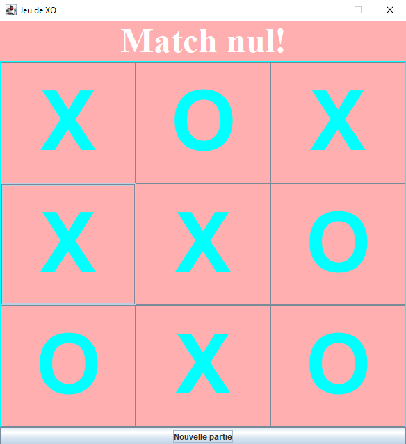

# Jeu de XO (Morpion)

# Description

Ce projet est un jeu de Morpion développé en **Java** avec une interface graphique réalisée avec **Swing**.

Le jeu permet à deux joueurs de s'affronter sur une grille de 3x3 cases :
- Le joueur **X** commence.
- Les joueurs placent leur symbole chacun leur tour.
- Le premier joueur qui aligne 3 symboles gagne.
- Si la grille est remplie sans gagnant, la partie se termine par un match nul.

##  Fonctionnalités

 Interface graphique avec Java Swing  
 Grille de jeu 3x3 dynamique  
 Alternance automatique entre les joueurs X et O  
 Détection des victoires :
- Lignes horizontales
- Colonnes verticales
- Diagonales

 Détection des matchs nuls  
 Blocage du jeu après la fin de la partie  
 Affichage du résultat de la partie

##  Technologies utilisées

- **Langage :** Java
- **Interface graphique :** Java Swing
- **IDE utilisé:** IntelliJ IDEA

##   Auteur

Projet réalisé par DJOUBER Dina dans le cadre de l'apprentissage de la programmation en **Java**.

