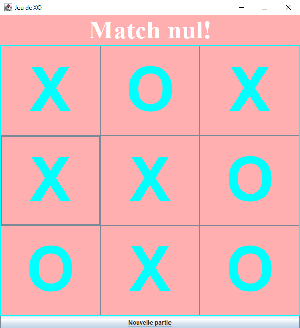

# Tic-Tac-Toe Game 

# Description

This project is a Tic-Tac-Toe game developed in **Java** with a graphical interface created using **Swing**.

The game allows two players to compete on a 3x3 grid:
- Player **X** starts.
- Players place their symbols one after another.
- The first player to align 3 symbols wins.
- If the grid is full without a winner, the game ends in a draw.

## Features

- Graphical interface with Java Swing
- Dynamic 3x3 game grid
- Automatic switching between players X and O
- Victory detection:
    - Horizontal lines
    - Vertical columns
    - Diagonals

- Draw detection
- Game blocking after the end of the match
- Display of the game result
- The possibility to start a new game at any moment

## Technologies Used

- **Language:** Java
- **Graphical Interface:** Java Swing
- **IDE Used:** IntelliJ IDEA

## Author

Project created by DJOUBER Dina as part of learning programming in **Java**.
